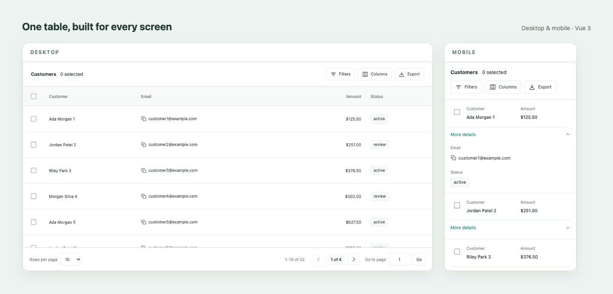

# Vue 3 Smart DataTable

[](https://github.com/reydi-dev/vue3-smart-datatable/actions/workflows/ci.yml)

A TypeScript-ready data table for Vue 3, with no required UI framework. Local and
async data use the same responsive table, with filters, sorting, selection, typed
slots, RTL, light/dark themes and optional CSV/persistence adapters.

[Live demo](https://reydi-dev.github.io/vue3-smart-datatable/) · [Quick start](#quick-start) · [Examples](#examples) · [API reference](https://github.com/reydi-dev/vue3-smart-datatable/blob/main/docs/api.md)

[](https://reydi-dev.github.io/vue3-smart-datatable/)

Desktop and mobile views captured from the live Vue 3 demo, arranged side by side.

The package name is `@reydi-dev/vue3-smart-datatable`.
Check the [npm package page](https://www.npmjs.com/package/@reydi-dev/vue3-smart-datatable)
for availability. The unrelated unscoped
`vue3-smart-datatable` package is a different project. The independent
[Vue 2 library](https://github.com/reydi-dev/vue2-smart-datatable) remains separate.

## Install

Install the stable release from npm:

```sh
npm install @reydi-dev/vue3-smart-datatable
```

Use Vue **3.5.44+**. The verified baseline is Vue 3.5.44, TypeScript 5.9.3 and
vue-tsc 3.3.13. The library is ESM-only; import its CSS explicitly. To build
and install a local archive:

```sh
# Build an actual local npm archive (Node 24.21.0 / npm 11+ tooling).
git clone https://github.com/reydi-dev/vue3-smart-datatable.git
cd vue3-smart-datatable
npm ci
npm run build
npm pack
```

Then, from your Vue 3 application directory:

```sh
npm install /absolute/path/to/reydi-dev-vue3-smart-datatable-0.1.0.tgz
```

The archive installation is checked in an independent project in CI. `latest` points to stable `0.1.0`; `next` remains on `0.1.0-beta.1`.

## Quick start

Copy this component into your application. CSS may instead be imported once in
your client entry. This exact example is typechecked against the installed package.

<!-- quick-start:start -->

```vue
<script setup lang="ts">
import SmartDataTable from '@reydi-dev/vue3-smart-datatable'
import '@reydi-dev/vue3-smart-datatable/styles.css'
import type { DataTableColumn } from '@reydi-dev/vue3-smart-datatable'
interface Customer {
  id: number
  name: string
  amount: number
}
const items: Customer[] = [
  { id: 1, name: 'Ada Morgan', amount: 125.5 },
  { id: 2, name: 'Jordan Patel', amount: 240 },
]
const columns: DataTableColumn<Customer>[] = [
  { key: 'name', label: 'Customer', sortable: true, filterable: true },
  {
    key: 'amount',
    label: 'Amount',
    type: 'number',
    numberFormat: { style: 'currency', currency: 'USD' },
  },
]
</script>
<template><SmartDataTable :columns="columns" :items="items" /></template>
```

<!-- quick-start:end -->

## Examples

| Example                                                                                                         | What it demonstrates                                              |
| --------------------------------------------------------------------------------------------------------------- | ----------------------------------------------------------------- |
| [Local data](https://github.com/reydi-dev/vue3-smart-datatable/blob/main/docs/examples/LocalExample.vue)        | Selection, filters, CSV and saved columns.                        |
| [Async provider](https://github.com/reydi-dev/vue3-smart-datatable/blob/main/docs/examples/AsyncExample.vue)    | Synthetic server, signal cancellation, filter/sort/page requests. |
| [HTTP provider](https://github.com/reydi-dev/vue3-smart-datatable/blob/main/docs/examples/http-provider.ts)     | Forward signal to fetch and validate unknown business rows.       |
| [Cells and actions](https://github.com/reydi-dev/vue3-smart-datatable/blob/main/docs/examples/SlotsExample.vue) | Typed specific slots and guarded action triggers.                 |
| [Persian / RTL](https://github.com/reydi-dev/vue3-smart-datatable/blob/main/docs/examples/RtlExample.vue)       | Messages, Persian numbers, responsive layout and theme.           |
| [Vue 2 migration](https://github.com/reydi-dev/vue3-smart-datatable/blob/main/docs/migration-from-vue2.md)      | Vue 3 models, emits, slots and public refs.                       |

Examples that import `./data.js` use the adjacent
[data.ts](https://github.com/reydi-dev/vue3-smart-datatable/blob/main/docs/examples/data.ts).
Every runnable example is copied into and typechecked in the independent tarball
consumer. The public demo uses those same example components.

## Models and interaction

Use `v-model` for selected **keys**, and `v-model:page`, `v-model:items-per-page`,
`v-model:sort`, `v-model:filters` or `v-model:visible-columns` when the parent owns
those values. Omit a model for internal state. A defined value is strictly
controlled: a fixed `:items-per-page="10"` keeps that value fixed; use v-model
when the built-in control should update it. Empty arrays and `sort=null` are
meaningful controlled values.

Set `row-clickable` explicitly to enable row activation. All twelve reference
cell kinds remain available, with plain text by default and typed slots for
custom content. Icons accept SVG definition objects; an external icon font is
not required. See the full
[API](https://github.com/reydi-dev/vue3-smart-datatable/blob/main/docs/api.md).

## Validation and scope

CI checks strict contracts, core/component/browser behavior, production
demo output and an independently installed npm tarball. The tarball consumer verifies
public types/CSS/adapters, normal client/server builds, Node import/SSR without
DOM globals, and controlled production hydration in Chromium at desktop/mobile
widths. The same table uses a desktop server/initial-client shell and switches
layout after mount on a narrow viewport.

This is scoped SSR evidence, not a Nuxt integration or a second-browser guarantee.
For SSR, keep server/client rows and formatter results consistent; choose an
explicit `dateFormat.timeZone` for dates that must render identically. See
[distribution evidence](https://github.com/reydi-dev/vue3-smart-datatable/blob/main/docs/distribution-validation.md).

Virtualization, inline editing, grouping/pivoting, multi-sort, Excel/PDF export and
a Nuxt module are outside the first-release scope. See the
[roadmap](https://github.com/reydi-dev/vue3-smart-datatable/blob/main/docs/roadmap.md)
and [progress](https://github.com/reydi-dev/vue3-smart-datatable/blob/main/docs/progress.md).

## Contribute and license

Use Node from `.nvmrc` and `npm ci`. `npm run validate` runs formatting, lint,
contracts, core/component checks, package outputs and both builds. After installing
Chromium, `npm run test:e2e` runs the interaction fixture and production demo;
`npm run test:consumer` checks the independent installed package and all documented
examples. See [CONTRIBUTING](https://github.com/reydi-dev/vue3-smart-datatable/blob/main/CONTRIBUTING.md).

Report reproducible issues with synthetic data. Use the
[security policy](https://github.com/reydi-dev/vue3-smart-datatable/blob/main/SECURITY.md)
for vulnerabilities. MIT, copyright Mohammad Reza Dehghani; see
[LICENSE](https://github.com/reydi-dev/vue3-smart-datatable/blob/main/LICENSE).
