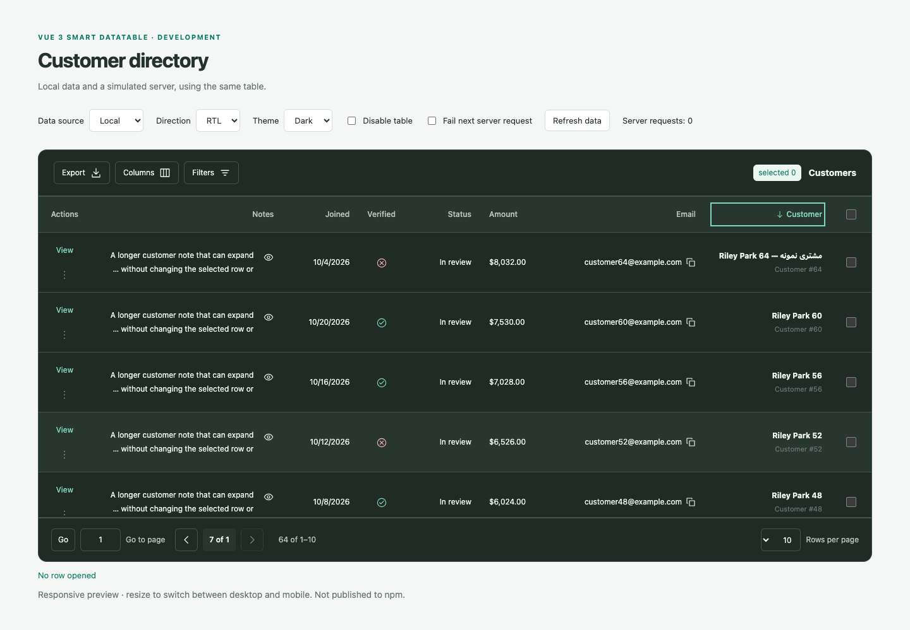
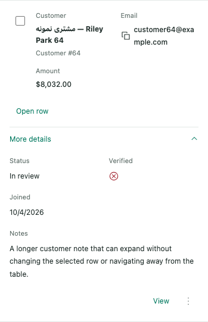
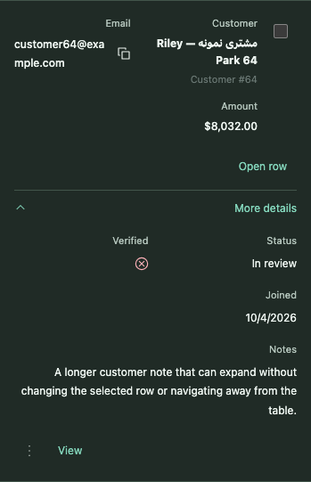

# Responsive visual review — stage 7

These are actual Chromium captures of the development playground, using synthetic
customer records. They retain the reference Clarity design and inherited system
font. They are review evidence, not generated mockups or screenshot assertions.
The maintainer tested the live built preview and approved stage 7 on 2026-10-28;
the stage has been merged. These captures remain its visual evidence.

## Desktop: RTL and dark

Captured at 1440 px with sorting, optional Notes, fixed-height scrolling and the
focused header button. The host controls remain LTR; table direction/theme are
scoped. At narrower desktop widths a wide set of columns intentionally scrolls
inside the named table region instead of making the host document overflow.

## Mobile: light and dark

These are crops of the first actual row at a 375 px viewport, with details open.
The remaining rows, toolbar and pagination are verified in the browser flows.
Content includes English/Persian names, formatted numbers/dates, an email copy
control, a full note, selection, an explicit Open row button and row actions.

| LTR / light                                                  | RTL / dark                                                 |
| ------------------------------------------------------------ | ---------------------------------------------------------- |
|  |  |

## What was checked

- Layout switches strictly below 960 px; the exact boundary is desktop.
- Selection/query/page and current-page open details survive layout changes;
  resizing alone does not refetch server data.
- Mobile details, Open row and actions support native keyboard interaction;
  disabled tables still allow reading details.
- Dialog Tab boundaries, Escape and focus return work in Chromium; desktop
  sorting and row activation work from the keyboard.
- Direction/palette remain scoped. Navigation mirrors in RTL and numeric ranges
  use bidi isolation. Both palettes pass the selected text-pair contrast target.
- Mobile document width stays within the viewport at 320/375 px. Long notes and
  an extra unbroken plain-text DOM sample wrap without page overflow. The images
  above precede that extra DOM mutation and show actual component data.
- All four Chromium E2E flows and 37 mounted component checks pass locally.

Local captures use Chromium 140.0.7339.16 via an existing executable on macOS 13.
CI uses Playwright's matching Chromium on Ubuntu. No second-browser or full
assistive-technology support claim is made. A source SSR/jsdom check verifies the
initial desktop hydration shell; independent packed-package/browser hydration is
still stage 8.

## Maintainer review

The maintainer approved the stage 7 visuals and interactions after testing the
live built preview on 2026-10-28. Stage 8 proceeds with distribution/types/SSR work.
npm publication, public Releases and demo hosting remain separate later approvals.
